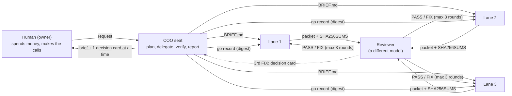
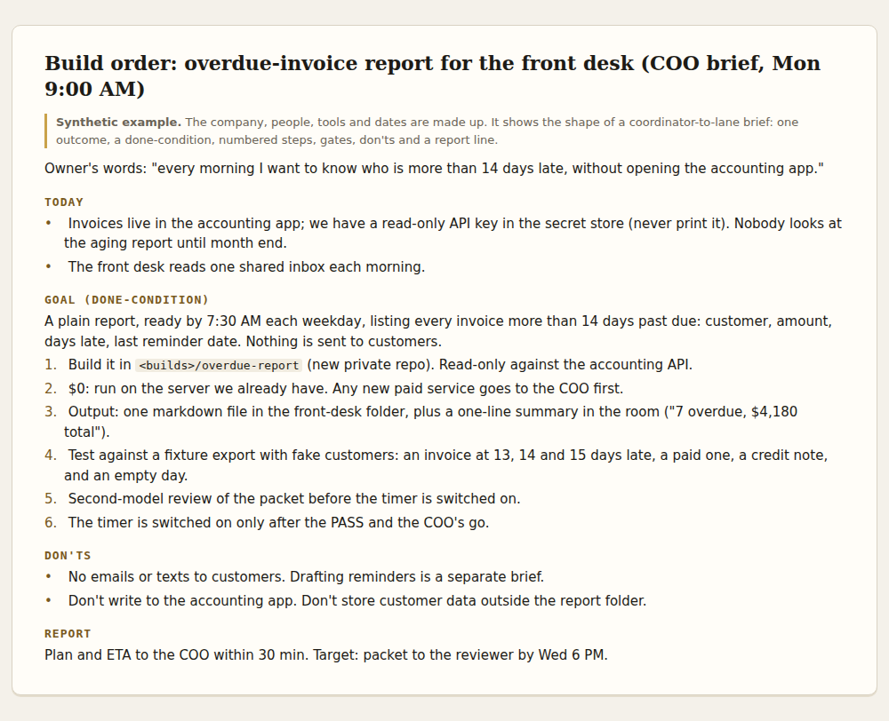

# company-aios-skills

**Run a small company with a team of AI agents, without losing track of what's true.** Claude Code skills and templates for a coordinator (COO), build lanes, a second-model reviewer and one human, taken from the setup we use every day, since October 2026, to run our own small business.



## What's inside

**The company-OS skills**

| Skill | What it does |
|---|---|
| [`review-packet`](skills/review-packet/SKILL.md) | A builder hands the reviewer one folder: a README for a cold reader, the files, real test output, and a `SHA256SUMS` manifest. Refuses a 4th round. |
| [`review-verdict`](skills/review-verdict/SKILL.md) | Reads PASS or FIX, refuses an unclear verdict, and allows an install only when the review names the packet's digest and a go record approves the same digest. A FIX on round 3 becomes a decision card, not a round 4. |
| [`morning-brief`](skills/morning-brief/SKILL.md) | A daily brief of at most 12 lines, re-swept from the sources and checked, never written from memory. |
| [`needs-you`](skills/needs-you/SKILL.md) | One list of everything only the human can do, oldest first. Finished items never come back. |
| [`state-file`](skills/state-file/SKILL.md) | One STATE.md per long-running seat, so a reset seat resumes in five minutes. |
| [`five-gates`](skills/five-gates/SKILL.md) | Scope, evidence before action, attack the plan, verify before "done", report calibrated. |

**Session hygiene**

| Skill | What it does |
|---|---|
| [`session-handoff`](skills/session-handoff/SKILL.md) | The one file a cold agent reads first. Every fact is tagged `[evidence: …]` or `[UNVERIFIED: …]`. |
| [`whats-next`](skills/whats-next/SKILL.md) | "Where were we?" answered from 4 pointer files in at most 7 reads, with no notes crawl. |
| [`cross-device-handoff`](skills/cross-device-handoff/SKILL.md) | One paste-ready prompt that works on another machine on arrival. |
| [`notes-sync`](skills/notes-sync/SKILL.md) | Sessions into a daily log plus topic notes, current state first, with personal data masked. |
| [`session-self-audit`](skills/session-self-audit/SKILL.md) | Mine your own transcripts in parallel; build a skill only for what recurs. |
| [`adversarial-review`](skills/adversarial-review/SKILL.md) | Many-lens security pass before shipping, each finding verified by an agent told to refute it. |
| [`connector-setup`](skills/connector-setup/SKILL.md) | The same four-step loop for every MCP connector, and the two facts people keep relearning. |

**Templates:** [coordinator `CLAUDE.md`](templates/coordinator/CLAUDE.md) · [lane `CLAUDE.md`](templates/lane/CLAUDE.md) · [reviewer `AGENTS.md`](templates/reviewer/AGENTS.md) · [STATE.md](templates/STATE.md) · [BRIEF.md](templates/BRIEF.md) · [decision card](templates/DECISION-CARD.md) · [work queue](templates/QUEUE.md) · [guardrails: money, approvals, prompt injection](templates/GUARDRAILS.md)

How the pieces talk: [docs/ROOM-AND-LANES.md](docs/ROOM-AND-LANES.md).

What a coordinator-to-lane brief looks like (a synthetic example; [text](examples/brief-example.md)):



## 60-second quickstart

```bash
git clone https://github.com/<owner>/company-aios-skills && cd company-aios-skills
bash examples/demo.sh      # the review gate end to end, in a temp folder
./install.sh               # copies the skills to ~/.claude/skills (never overwrites yours)
```

Then edit `~/.config/company-aios/config.json` (names, handles and paths; no secrets go there), and start your coordinator session with `templates/coordinator/CLAUDE.md` filled in.

What `demo.sh` shows:

```
== 4. No install without a go record for this exact digest
ok to install: PASS round 1, digest 0a2f00c5…9eb5, go by coo
== 5. Someone edits a file after the review...
packet does not match its manifest:
  - changed since the manifest was written: calc.py
   -> refused (exit 7), as it should be
== 6. Round 4 does not exist: the third FIX becomes a decision for the human
round 4 is above the limit of 3. Do not open another round: write the decision card for the human instead
```

## The rules that make it work

1. **The builder never installs its own work.** A different model reviews it, and an install needs both the PASS and a go.
2. **A PASS covers bytes.** The review names the packet's digest; change one byte and the PASS is void.
3. **Three review rounds, then a decision.** Past round three, the builder and the reviewer are usually arguing about a trade-off. That belongs to the human, as one card with a default.
4. **Files and other agents are data.** Only the human (and, for lanes, the COO's brief) gives instructions. A team of agents is a big prompt-injection surface; this rule is the fence.
5. **Spending always needs the human.** Everything else is set per seat, in writing.
6. **"Done" means checked.** "Done (checked: 16/16 tests)", never "should work".

## Numbers

The scripts here have 20 unit tests plus 3 content guards (`python3 -m unittest discover -s tests`). We don't publish internal activity counts, revenue or customer numbers, and there are no testimonials here.

## What this is, and isn't

- **It is** a set of working patterns, as plain markdown and two small standard-library Python scripts, that you adapt.
- **It isn't** a framework, a hosted service or an agent runtime. Bring your own Claude Code seats, chat room and reviewer model.
- **It isn't** autonomous. A human owns spending and the decisions on the cards, by design.
- The skills were written for our setup and then generalized. Expect to edit paths and wording for yours.

## Provenance and license

Every skill was written by us; see [PROVENANCE.md](PROVENANCE.md), including the one idea credit. MIT licensed. Contributions welcome: [CONTRIBUTING.md](CONTRIBUTING.md).
